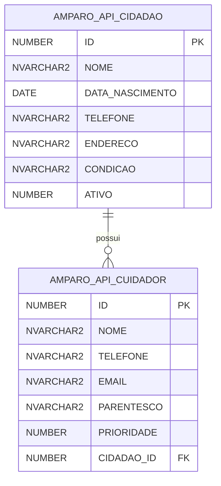

# AMPARO API — Global Solution CitizenTech 2026/2

API REST em ASP.NET Core 8 para gerenciar cidadãos assistidos e sua rede de cuidadores. O AMPARO atende idosos e pessoas com deficiência (PcD) que podem precisar de ajuda rápida em quedas ou mal súbito, conectando cada cidadão a uma rede de apoio. Alinha-se aos ODS 3 (Saúde e Bem-Estar) e 10 (Redução das Desigualdades).

## Integrantes — 2TDSPB

| Nome | RM |
|---|---:|
| Matheus Carneiro Maciel | 567753 |
| Murilo Marques Cabral | 568224 |
| Paulo Henrique da Silva Kian | 563343 |

## Modelo 1:N

```text
AMPARO_API_CIDADAO (ID PK)  1 ──────── N  AMPARO_API_CUIDADOR
                                             ID PK
                                             CIDADAO_ID FK
```



Um cidadão assistido pode possuir vários cuidadores; cada cuidador pertence a um único cidadão. O modelo veio do relacionamento original `CIDADAO.id ← CUIDADOR.cidadao_id` do `AMPARO.sql`. A API usa o prefixo `AMPARO_API_` para não conflitar nem apagar as seis tabelas, sequences, procedures e registros da entrega de Banco de Dados.

Ao excluir um cidadão que ainda possui cuidadores, a API devolve `409 Conflict`. A exclusão em cascata foi evitada para preservar a rede de apoio.

## Tecnologias e estrutura

- .NET SDK 8.0.428 (fixado em `global.json`) / ASP.NET Core Web API com controllers
- Entity Framework Core 8.0.22
- Oracle Entity Framework Core 8.23.80
- Oracle FIAP em `oracle.fiap.com.br`
- Swagger/OpenAPI

```text
Controllers/              rotas, status HTTP e operações CRUD
Models/                   entidades e validações por Data Annotations
Data/AmparoDbContext.cs   mapeamento 1:N e nomes dos objetos Oracle
Migrations/               migration inicial e snapshot versionados
Program.cs                injeção do DbContext, controllers e Swagger
docs/                     roteiros de vídeo e apresentação
```

## Configuração segura do Oracle

Nunca coloque RM ou senha no `appsettings.json`. No PowerShell, a partir da raiz:

```powershell
dotnet user-secrets set "ConnectionStrings:Oracle" "User Id=RM000000;Password=SENHA_FICTICIA;Data Source=oracle.fiap.com.br:1521/ORCL"
```

Substitua serviço/porta se a configuração fornecida pela FIAP for diferente. Alternativamente, somente na sessão atual:

```powershell
$env:ConnectionStrings__Oracle = "User Id=RM000000;Password=SENHA_FICTICIA;Data Source=oracle.fiap.com.br:1521/ORCL"
```

## Restaurar, migrar e executar

```powershell
dotnet --version
dotnet restore
dotnet build
dotnet tool restore
dotnet ef migrations list
dotnet ef database update
dotnet run
```

O comando de versão deve mostrar `8.0.428`. O restore e o build devem terminar sem erros. `database update` deve informar a aplicação de `InitialCreate`; esse comando cria somente `AMPARO_API_CIDADAO`, `AMPARO_API_CUIDADOR`, o índice/FK e `__EFMigrationsHistory`. Acesse `http://localhost:5090/swagger`.

Para confirmar no Oracle:

```sql
SELECT * FROM "__EFMigrationsHistory";

SELECT table_name FROM user_tables
WHERE table_name IN ('AMPARO_API_CIDADAO', 'AMPARO_API_CUIDADOR')
ORDER BY table_name;
```

> Situação verificada em 19/11/2026: a migration `20261119135934_InitialCreate` foi **gerada, versionada e aplicada** no Oracle FIAP. As tabelas, a FK, o índice e o registro em `__EFMigrationsHistory` foram criados com sucesso.

## CRUD e status HTTP

As duas entidades têm `GET` coleção (`200`, inclusive `[]`), `GET /{id}` (`200`/`404`), `POST` (`201` e cabeçalho `Location`), `PUT /{id}` (`204`/`404`) e `DELETE /{id}` (`204`/`404`). Dados inválidos retornam `400` em JSON. O cuidador também valida se a FK aponta para um cidadão existente.

### Sequência no Postman

Base: `http://localhost:5090`. Guarde os IDs retornados pelos POSTs como `cidadaoId` e `cuidadorId`.

1. `GET /api/cidadaos` — esperado `200` e `[]` na primeira execução.
2. `POST /api/cidadaos` — esperado `201`:

```json
{
  "nome": "Maria da Silva",
  "dataNascimento": "1944-03-15",
  "telefone": "(11) 98765-1001",
  "endereco": "Rua das Flores, 120 - São Paulo/SP",
  "condicao": "Mobilidade reduzida",
  "ativo": true
}
```

3. `POST /api/cidadaos` omitindo somente `dataNascimento` do JSON válido acima — esperado `400`, com erro no campo `DataNascimento`. Repita com `"dataNascimento": null`; o resultado também deve ser `400`.
4. `PUT /api/cidadaos/{cidadaoId}` omitindo somente `dataNascimento` — esperado `400`. Faça um GET em seguida e confirme que a data anterior não mudou.
5. `PUT /api/cidadaos/{cidadaoId}` com todos os campos e uma nova data válida — esperado `204`. Confirme a nova data com GET.
6. `POST /api/cuidadores` — troque `cidadaoId` pelo ID anterior; esperado `201`:

```json
{
  "nome": "Fernanda Silva",
  "telefone": "(11) 99001-0001",
  "email": "fernanda.silva@email.com",
  "parentesco": "Filha",
  "prioridade": 1,
  "cidadaoId": 1
}
```

7. `GET /api/cidadaos/{cidadaoId}` e `GET /api/cuidadores/{cuidadorId}` — `200`.
8. `PUT /api/cuidadores/{cuidadorId}` — envie todos os campos, alterando prioridade; `204`.
9. `POST /api/cuidadores` com `cidadaoId: 999999` — `400` com mensagem de FK inexistente.
10. `POST /api/cidadaos` com `{ "nome": "" }` — `400` com objeto `mensagem` e `erros`.
11. `GET /api/cidadaos/999999` — `404` em JSON.
12. `DELETE /api/cidadaos/{cidadaoId}` antes do cuidador — `409`, pois há dependente.
13. Enquanto os dois registros de teste ainda existirem, execute o JOIN abaixo no Oracle e registre a evidência.
14. Somente depois do JOIN, faça `DELETE /api/cuidadores/{cuidadorId}` — `204`; depois `DELETE /api/cidadaos/{cidadaoId}` — `204`.

```sql
SELECT c.ID AS CIDADAO_ID, c.NOME AS CIDADAO,
       u.ID AS CUIDADOR_ID, u.NOME AS CUIDADOR,
       u.PARENTESCO, u.PRIORIDADE
FROM AMPARO_API_CIDADAO c
JOIN AMPARO_API_CUIDADOR u ON u.CIDADAO_ID = c.ID
WHERE c.ID = :cidadao_id;
```

## Evidências e situação dos critérios

| Critério | Valor | Evidência | Pendência |
|---|---:|---|---|
| API compilando e executando pelo README | 20 | `dotnet build`: 0 erros e 0 avisos; Swagger configurado | Repetir no computador do apresentador |
| Modelo 1:N e validações | 20 | `Models/` e `AmparoDbContext` | Nenhuma no código |
| EF Core + Oracle com migrations aplicadas | 25 | Provider Oracle, migration, snapshot e `database update` concluído no Oracle FIAP | Capturar evidência visual no SQL Developer |
| CRUD completo/status corretos | 20 | Cinco operações testadas para cada entidade no Oracle; `200`, `201` e `204` confirmados | Repetir no Postman para gravar a apresentação |
| Erros 400/404 | 10 | `400`, `404` e restrição `409` confirmados contra o Oracle | Capturar evidências no Postman |
| README completo | 5 | este arquivo | Preencher links no Portal |

## Antes de entregar

- Confirmar repositório GitHub público e acessível em janela anônima.
- Versionar `Migrations/`; nunca versionar senha, `bin/` ou `obj/`.
- Aplicar e verificar a migration no Oracle.
- Executar o Postman na ordem, consultar o JOIN antes de apagar os registros e capturar evidências.
- Preencher os links marcados em `ENTREGA_PORTAL.txt` e respeitar o prazo do Portal.

